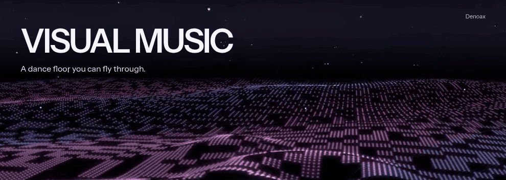
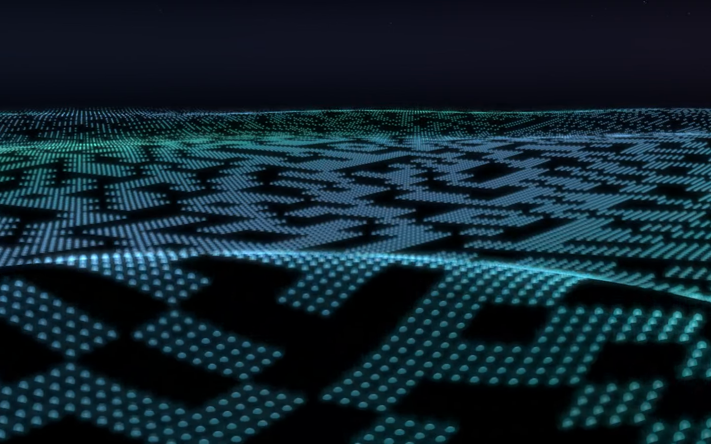
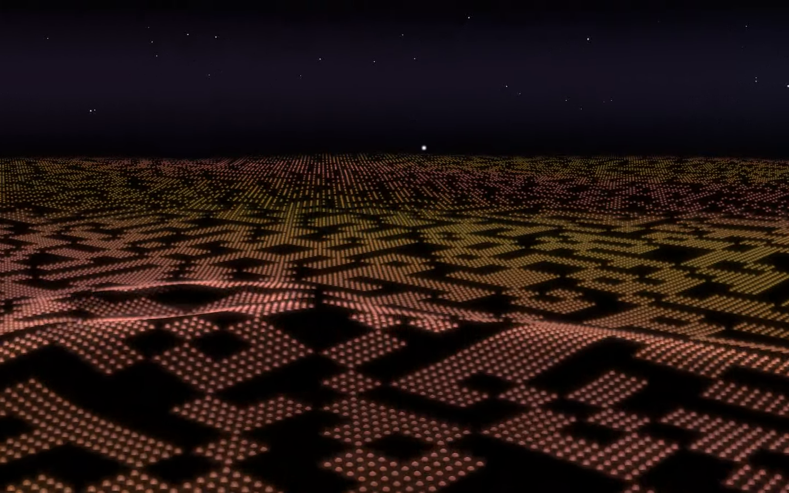
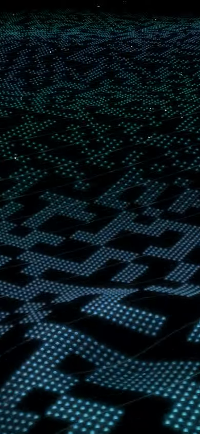

<div align="center">

<picture>
  <source media="(prefers-reduced-motion: reduce)" srcset="showcase/github/visual-music-loop-poster.webp">
  
</picture>

# Visual Music

**A dance floor you can fly through.**<br>
Raised waves, luminous grids and a continuous journey through *Around the World (La La La La La)*.

[](https://threejs.org/) [](https://www.typescriptlang.org/) [](https://vite.dev/)

[Experience](#the-experience) · [Controls](#controls) · [Run locally](#run-locally) · [Architecture](#architecture) · [Verification](#verification) · [Credits](#credits)

*The banner uses actual scene footage with a short lap edit. Reduced motion selects a still.*

</div>

## The experience

One Start action opens the music scene. Fly low over an endless LED floor while physical waves spread from fixed emitters. Local chunks trade light as the waves arrive: bulbs genuinely switch off, leaving dark space between coloured grids, chases and held palettes. Soft stars move through the same world.

| Cool light | Warm light |
|:---:|:---:|
|  |  |

Steering changes the travelled path. Holding the scene accelerates; releasing settles the flight. The floor carries the musical movement while the horizon stays stable.

The complete recording plays once. After its audible tail, the scene eases back over eight seconds into a repeating twelve-second visual idle. The visuals continue; the song only restarts when you choose Replay.

<details>
<summary><strong>Portrait view</strong></summary>

<br>

<p align="center">
  
</p>

The recorded portrait view uses browser-emulated touch and viewport geometry. Physical phone performance and touch review remain pending.

</details>

## Controls

| Action | Input |
|:---|:---|
| Begin | Start |
| Turn and tilt | Move the pointer; drag one primary finger; focus the scene and use arrows or WASD |
| Accelerate | Hold the left pointer button or primary touch on the scene |
| Pause / resume | Playback menu or Space |
| Replay from sample zero | Replay |
| Adjust playback and rendering | Settings: volume, mute, brightness and reduced motion |
| Close a pane | Close or Escape |

Opening Settings keeps the music running. The native pointer remains visible. Playback interruptions and graphics recovery retain the presentation position; duplicate activation is guarded.

## Run locally

Requires Node.js 22 and npm. Use the supplied lockfile and exact audio file.

```sh
npm ci
npm run build
npm run preview -- --port 4175 --strictPort
```

Open **http://127.0.0.1:4175/**. For development, run `npm run dev`. The configured server binds to loopback.

The bundled MP3 is unchanged: `public/audio/around-the-world.mp3`. Its browser-decoded duration is 219.66579 seconds. One audio source and `AudioTransport.presentation` own musical time, including pause, recovery and the full ending.

```text
SHA-256: 47119d6e77b41e51ef65fb2fc7fa46a2c3f7a75578a650f394b5df78137861a0
```

## Architecture

| Area | Source | Responsibility |
|:---|:---|:---|
| Application | [`src/main.ts`](src/main.ts), [`src/input.ts`](src/input.ts) | Transport actions, input lifecycle, preferences and recovery |
| Audio | [`src/audio/transport.ts`](src/audio/transport.ts), [`core`](core) | Audio graph, sample-zero playback and presentation time |
| Flight | [`src/scene/flight.ts`](src/scene/flight.ts) | Sole route/camera owner, steering and snapshots |
| Rendering | [`src/scene/world.ts`](src/scene/world.ts), [`src/scene/field.ts`](src/scene/field.ts) | Terrain, mounted bulbs, floor lighting, stars and depth |
| Score | [`analysis`](analysis), [`show`](show) | Hash-bound measurements, events and current as-built records |
| Provenance | [`assets`](assets), [`sources`](sources) | Notices, source studies and recoverable retired work |
| Review | [`tools`](tools), [`evidence/dance-floor-only`](evidence/dance-floor-only) | Runtime checks, capture tools and documentation exports |

The current scene is dance-floor-only. Mountains, folded fins, floating actors, ribbons and beams have no live construction, update, reset or recovery paths, and no models ship in the production build. Their originals remain under [`sources/retired-stage-scenery-65787fd`](sources/retired-stage-scenery-65787fd) and the local recovery branch. The existing BUMER.EXE source paths and history remain intact. Historical modules and scores are retained records; [`show/CURRENT_AUTHORITY.md`](show/CURRENT_AUTHORITY.md) identifies the active implementation.

## Verification

```sh
npm test
npm run validate
npm run validate:review
npm run test:browser
```

Set `BUMER_CHROME` to an installed compatible Chromium executable for browser checks. The historical checkout and developer API names stay intact.

The floor-only review includes 119 passing individual Node checks, targeted real-browser interaction/recovery checks and actual GPU probes for OFF emission, surface registration and star depth. The retained local review recordings cover the complete audio, ending and two visual-idle periods. The published snapshot is independently rebuilt and compared with that reviewed runtime. Full recordings and review archives remain local; compact technical receipts are under `evidence/dance-floor-only`.

These are technical checks. Continuous human visual/listening approval, physical-device touch and audiovisual alignment, native foreground performance ownership and formal flash review remain pending. One interrupted portrait attempt is preserved as a failure; the fresh standalone recording passed. See [`VALIDATION.md`](VALIDATION.md) and [`RELEASE.md`](RELEASE.md) for scope and remaining limits.

## Credits

- Project and art direction: **Mani Marami Milani / Denoax**.
- Rendering and interaction studies: [HelloEnjoy Lights](https://helloenjoy.itch.io/lights) and [Fantasynth](https://live.fantasynth.com/), adapted in original Three.js/GLSL. Inspection limits remain in the source records.
- Portfolio-derived controls, original GPU glass sources and Instrument Sans: [source notices and attribution](assets/ATTRIBUTION.md).
- Music: the exact user-supplied *Around the World (La La La La La)* recording; [asset manifest](assets/manifest.json). Bundling does not grant additional music redistribution rights.
- Current repository presentation: real Visual Music browser captures, following the wide banner, centered introduction and screenshot-led structure of [Mani's portfolio](https://github.com/Denoax/portfolio) and [Kona Desktop](https://github.com/Denoax/konata-hyprland-dotfiles). [Showcase source record](showcase/github/README.md).

Retired asset credits remain preserved. No model-generated visual media are used. Apply `$reference-led-design` to visual continuations and preserve the current approval boundary. This repository publishes the source and documentation. Complete review recordings remain local; hosting is separate.
